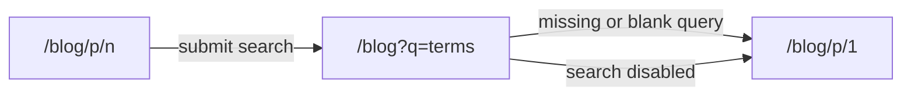

# Blog listing search

Blog search is an optional, client-side feature for the listing experience. It searches
post titles, tags, primary topics, and excerpts, then ranks matches using configurable
field weights.

Update this document whenever the search behavior, configuration, or routing changes.

## Enable search

Search is disabled by default. Enable it in the library config:

```ts
export const blogConfig = createBlogConfig({
  // site and content...
  search: {
    enabled: true,
  },
});
```

The host must also provide the search route:

```tsx
// src/app/blog/page.tsx
import { createBlogSearchPage } from "admindoor-blog/next";
import { blogConfig } from "@/lib/blog-config";

const searchPage = createBlogSearchPage(blogConfig);

export const generateMetadata = searchPage.generateMetadata;
export default searchPage.default;
```

Continue using `getBlogRedirects(blogConfig)` in `next.config.ts`. When search is
enabled, its `/blog` redirect only runs when the configured query parameter is absent.

## Routing flow



`/blog` is a **static search shell**: posts are fetched once at build/request time and
shipped to the client as searchable records. The `q` query param is read only in the
browser (not by the server page), so the route stays compatible with
`output: "export"` and other static hosts. Baking a server `redirect()` for an empty
query would turn `/blog` into a permanent redirect to `/blog/p/1` and break
`/blog?q=…` (hosts preserve the query → `/blog/p/1?q=…`).

Bare `/blog` (no `q`) is handled by `getBlogRedirects` on the host/CDN. If that
redirect is absent (for example local navigation), the client search island replaces
to `/blog/p/1`. The client reads `q` in `useLayoutEffect` and only then renders
results, so the static shell does not flash empty results before the URL sync.
Further searches on the results page update browser history and reuse the in-memory
client index without another server fetch.

The paginated listing remains statically generated. Its search input is a small client
island that navigates to the search URL.

## Configuration

```ts
search: {
  enabled: true,
  maxQueryLength: 100,
  queryParam: "q",
  placeholder: "Search articles…",
  emptyResultsMessage: "No articles match your search.",
  fieldWeights: {
    title: 1,
    tags: 1,
    primaryTopic: 1,
    excerpt: 1,
  },
}
```

| Setting               | Default                            | Description                                             |
| --------------------- | ---------------------------------- | ------------------------------------------------------- |
| `enabled`             | `false`                            | Shows search and enables the search route               |
| `maxQueryLength`      | `100`                              | Maximum query character count                           |
| `queryParam`          | `"q"`                              | Search URL parameter                                    |
| `placeholder`         | `"Search articles…"`               | Input placeholder                                       |
| `emptyResultsMessage` | `"No articles match your search."` | No-match message                                        |
| `fieldWeights.*`      | `1`                                | Non-negative score multiplier for each searchable field |

The input uses `maxLength`, and both the route and client truncate bypassed values to
`maxQueryLength`. Queries are trimmed and repeated whitespace is collapsed.

## Search and scoring

The client builds an Orama index once for the current post dataset:

1. Searchable fields (`title`, `tags`, `primaryTopic`, `excerpt`) are indexed in the browser.
2. English stop words are removed and English stemming is applied.
3. `fieldWeights` are applied as Orama field boosts.
4. Search uses threshold `1`, so all meaningful query terms must match somewhere in a post.
5. Results are sorted by relevance score.
6. Equal scores are ordered by newest publication date.

Terms can match across fields. For example, one term may match a tag while another
matches the excerpt. No search-result pagination is applied.

Search result pages are marked `noindex, follow`; post pages and paginated listing SEO
remain unchanged.
